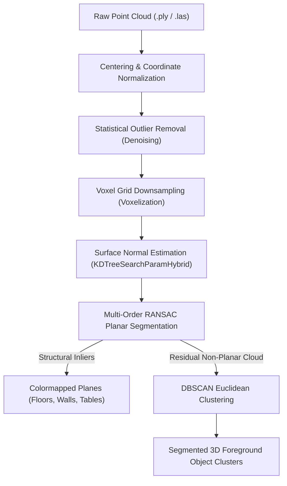

# 3D Spatial Deep Learning & Point Cloud Processing Pipeline

[](https://www.python.org/)
[](http://www.open3d.org/)
[](https://numpy.org/)
[](LICENSE)

An end-to-end tutorial and practical implementation pipeline for **3D Spatial Deep Learning** and **Point Cloud Processing**. This repository covers core geometric algorithms, spatial filtering, spatial indexing, normal vector estimation, multi-order RANSAC planar decomposition, and Euclidean DBSCAN instance clustering.

---

## 🎯 Tutorial Objectives

The primary objective of this tutorial is to demystify raw 3D spatial data handling and establish a foundational understanding of classical and modern point cloud processing techniques.

By completing this tutorial, you will learn how to:
1. **Ingest and Normalize 3D Geometries**: Load standard 3D point cloud formats (`.ply`, `.las`, etc.) and translate coordinate frames to geometric centroids for numerical stability.
2. **Filter Geometric Noise**: Apply statistical outlier removal (k-nearest neighbors standard deviation thresholds) to strip LiDAR/sensor noise and ambient artifacts.
3. **Downsample via Voxel Grids**: Discretize continuous 3D space into regular voxel grids to reduce point density uniformly while preserving underlying geometric topology.
4. **Estimate Local Surface Normals**: Compute curvature and tangent planes using hybrid radius/k-NN KD-Tree neighborhood searches.
5. **Understand Spatial Partitioning Algorithms**: Explore recursive binary space partitioning via a from-scratch **KD-Tree** implementation supporting multidimensional range search queries.
6. **Extract Geometric Primitives with RANSAC**: Apply iterative Random Sample Consensus (RANSAC) to identify and segment dominant structural planes (floors, walls, ceilings, tabletops).
7. **Perform Multi-Instance Object Clustering**: Partition remaining unsegmented non-planar objects into distinct spatial instances using density-based Euclidean clustering (DBSCAN).

---

## 🏗️ Pipeline Architecture



---

## 📂 Project Structure

```plaintext
.
├── KDTree.py              # Custom k-d tree data structure implementation with range query
├── pipeline.ipynb         # Step-by-step interactive Jupyter notebook walkthrough
├── voxel_generation.py    # Complete standalone Python execution pipeline
├── test.py                # Quick verification script for Open3D point cloud loading
├── requirements.txt       # Project dependencies
└── README.md              # Project documentation and tutorial guide
```

---

## 🔬 Pipeline Stage Breakdown

### 1. Data Ingestion & Centering
Raw point clouds often originate in arbitrary real-world coordinate systems. Shifting the point cloud center to the origin `(0, 0, 0)` eliminates large offset magnitudes and improves numerical conditioning:
```python
pcd = o3d.io.read_point_cloud(dataset.path)
pcd_centre = pcd.get_center()
pcd.translate(-pcd_centre)
```

### 2. Statistical Outlier Removal (SOR)
Sensor capture imperfections introduce sparse airborne noise. Points are evaluated against their $k$-nearest neighbors ($k=16$); points whose mean neighbor distance exceeds a standard deviation threshold ($\alpha = 10$) are classified as outliers and removed:
```python
filtered_pcd, outlier_indices = pcd.remove_statistical_outlier(
    nb_neighbors=16,
    std_ratio=10.0
)
```

### 3. Voxel Grid Downsampling
High-resolution scans often feature millions of redundant points. A regular 3D grid with voxel size $v = 0.01\text{ m}$ is overlaid on the cloud. All points inside each voxel are pooled into a single centroid point:
```python
pcd_downsampled = filtered_pcd.voxel_down_sample(voxel_size=0.01)
```

### 4. Surface Normal Estimation
Surface normals provide essential local orientation for 3D deep learning models (such as PointNet++ or DGCNN). Normals are estimated using covariance analysis on a hybrid neighborhood search combining a spatial radius ($r = 4 \times \bar{d}_{\text{NN}}$) and maximum nearest neighbors ($k = 16$):
```python
pcd_downsampled.estimate_normals(
    search_param=o3d.geometry.KDTreeSearchParamHybrid(radius=radius_normals, max_nn=16),
    fast_normal_computation=True
)
```

### 5. Multi-Order RANSAC Planar Segmentation
In indoor and outdoor scenes, dominant planes correspond to floors, walls, and tables. RANSAC randomly samples triplets of points to fit plane equations ($ax + by + cz + d = 0$). By executing multi-pass RANSAC iteratively, dominant planes are extracted sequentially:
```python
max_plane_idx = 6
segments = {}
rest = pcd

for i in range(max_plane_idx):
    plane_model, inliers = rest.segment_plane(
        distance_threshold=0.02,
        ransac_n=3,
        num_iterations=1000
    )
    segments[i] = rest.select_by_index(inliers)
    rest = rest.select_by_index(inliers, invert=True)
```

### 6. Euclidean Object Clustering (DBSCAN)
Once structural planes are stripped away, the residual point cloud contains isolated foreground objects. Density-Based Spatial Clustering of Applications with Noise (DBSCAN) groups spatially contiguous points into individual entity clusters:
```python
labels = np.array(rest.cluster_dbscan(eps=0.05, min_points=5))
max_label = labels.max()
print(f"Point cloud segmented into {max_label + 1} independent object clusters.")
```

---

## 🧠 Algorithmic Spotlight: Custom KD-Tree (`KDTree.py`)

In spatial data science, nearest neighbor search and range queries in $\mathcal{O}(N)$ brute-force complexity become prohibitive. A **k-d tree** (k-dimensional tree) partitions space recursively along alternating dimensions, achieving average $\mathcal{O}(\log N)$ lookups.

This repository includes a standalone Python implementation in `KDTree.py`:
- **Recursive Splitting**: Splits along median points cycling across dimensions $d \in \{0, 1, \dots, k-1\}$.
- **Range Search (`rangesearch`)**: Efficient bounding box queries yielding all points satisfying $\text{box}[i][0] \le p_i \le \text{box}[i][1]$.

Run the KD-Tree demo:
```bash
python KDTree.py
```

---

## 🚀 Execution Guide

### Option 1: Interactive Jupyter Notebook (Recommended)
Launch the interactive notebook to visualize each processing stage step-by-step:
```bash
jupyter notebook pipeline.ipynb
```

> **Note for Jupyter Users**: Open3D leverages a WebRTC-based visualizer when executing within web notebooks.

### Option 2: Standalone Pipeline Script
Execute the complete end-to-end pipeline via terminal:
```bash
python voxel_generation.py
```

### Option 3: Quick Sanity Test
Test Open3D installation and native GUI viewer rendering:
```bash
python test.py
```

---

## 📦 Requirements & Installation

Follow these steps to configure your environment and install all necessary dependencies.

### 1. Prerequisites
- **Python**: Version `3.9` to `3.12` recommended.
- **C++ Redistributables / OpenGL support** (required by Open3D on Windows/Linux).

### 2. Set Up a Virtual Environment

It is recommended to run this project in an isolated virtual environment:

#### Using `venv` (Standard Python):
```bash
# Create virtual environment
python -m venv venv

# Activate on Windows (PowerShell):
.\venv\Scripts\Activate.ps1

# Activate on Windows (Command Prompt):
.\venv\Scripts\activate.bat

# Activate on macOS / Linux:
source venv/bin/activate
```

#### Using `conda`:
```bash
# Create conda environment
conda create -n spatial3d python=3.11 -y

# Activate conda environment
conda activate spatial3d
```

### 3. Install Dependencies

Install all required packages from `requirements.txt`:
```bash
pip install --upgrade pip
pip install -r requirements.txt
```

Alternatively, install the core packages manually:
```bash
pip install numpy open3d laspy matplotlib notebook ipykernel
```

### 4. Verification
Verify that your installation can access Open3D and render geometries:
```bash
python -c "import open3d as o3d, numpy as np; print('Open3D version:', o3d.__version__)"
```

---

## 📜 License
This project is open-source and available under the [MIT License](LICENSE).

